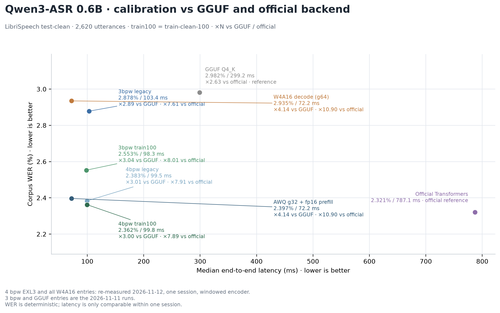
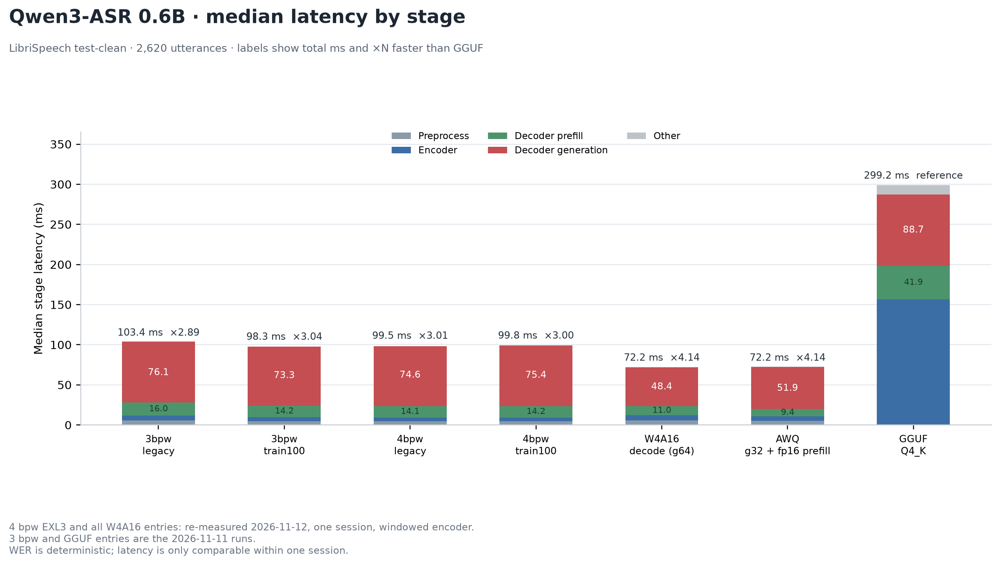
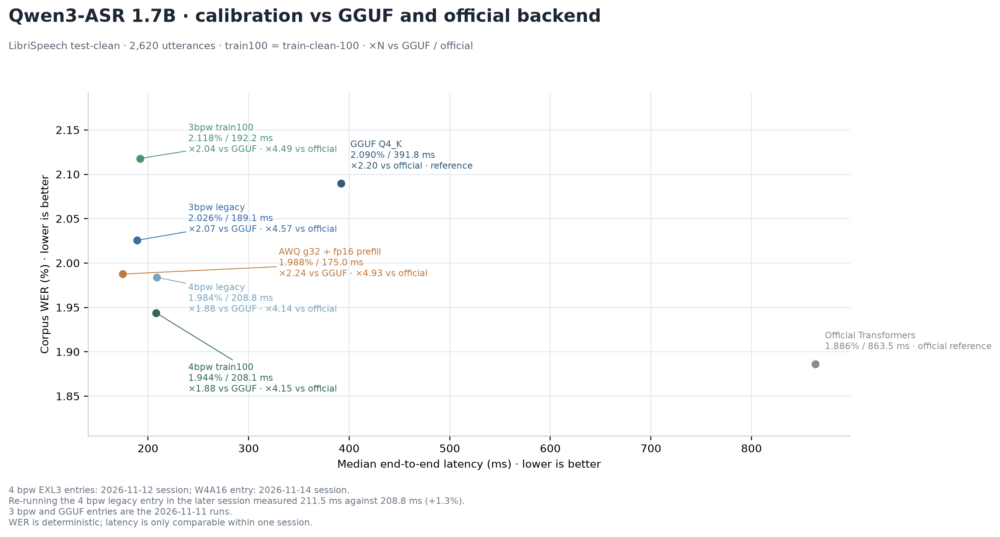
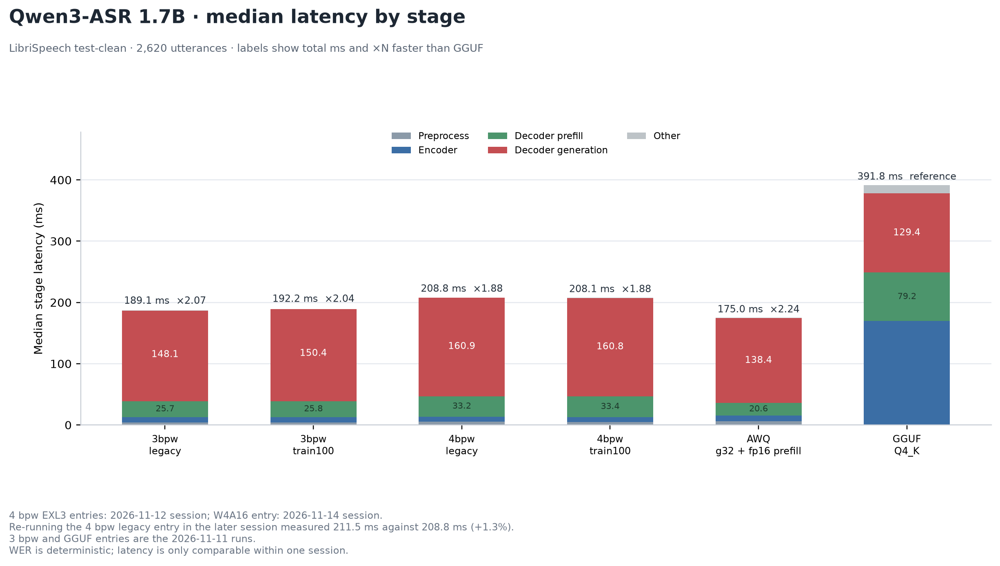
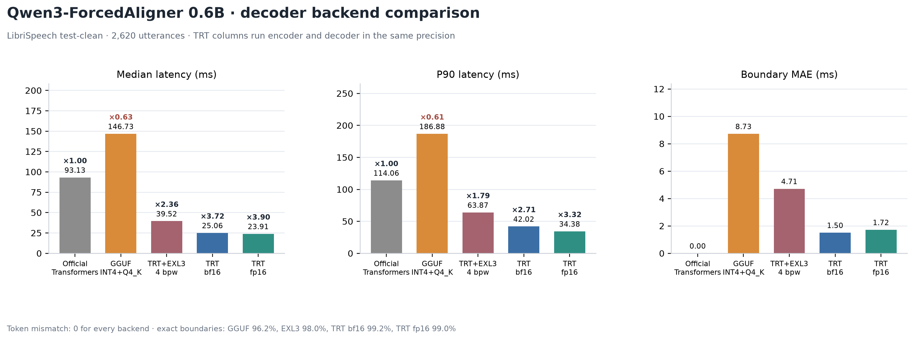
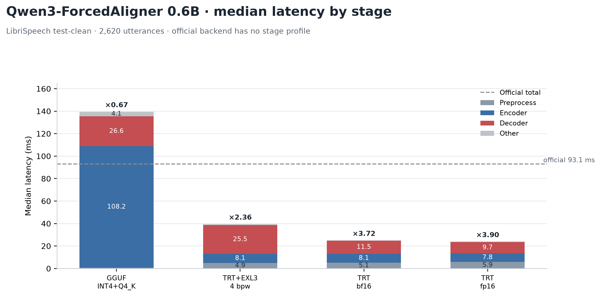

# Qwen3-ASR TensorRT

Windows-tested inference for Qwen3-ASR 0.6B and 1.7B using a TensorRT audio encoder and one of two text decoders: an ExLlamaV3 EXL3 decoder, or a fully TensorRT decoder with INT4 weight-only (W4A16) kernels. This repository integrates both stages and provides a Python CLI and HTTP API.

[English](README.md) | [简体中文](README.zh-CN.md) | [Model files](model-cards/)

## Requirements

- Windows 10/11, NVIDIA GPU, and CUDA 12.8
- Python 3.10–3.13 and `uv`
- TensorRT 11.4.0.106
- A compatible PyTorch and ExLlamaV3 build

Linux should work when compatible CUDA, TensorRT, PyTorch, and ExLlamaV3 packages are available.

Install the project dependencies:

```powershell
uv sync
```

## Models

The project supports [`Qwen/Qwen3-ASR-0.6B-hf`](https://huggingface.co/Qwen/Qwen3-ASR-0.6B-hf) and [`Qwen/Qwen3-ASR-1.7B-hf`](https://huggingface.co/Qwen/Qwen3-ASR-1.7B-hf), with BF16 and FP16 TensorRT encoder builds, optional local INT8 Q/DQ encoder calibration, EXL3 3/4 bpw decoder weights, and a TensorRT W4A16 decoder (INT4 weights, FP16 activations, AWQ-scaled).

Published model files:

- [TensorRT encoder: BF16 and FP16 ONNX](https://huggingface.co/Retrieve0/Qwen3-ASR-1.7B-TensorRT-Encoder)
- [EXL3 decoder: legacy 3 bpw and 4 bpw](https://huggingface.co/Retrieve0/Qwen3-ASR-1.7B-EXL3-Decoder)
- [1.7B EXL3 3 bpw, recalibrated with train-clean-100](https://huggingface.co/Retrieve0/Qwen3-ASR-1.7B-EXL3-Decoder/tree/main/decoder-exl3-3bpw-train-clean-100) (separate directory in the same decoder repository)
- [1.7B EXL3 4 bpw, recalibrated with train-clean-100](https://huggingface.co/Retrieve0/Qwen3-ASR-1.7B-EXL3-Decoder/tree/main/decoder-exl3-4bpw-train-clean-100) (separate directory in the same decoder repository)
- [0.6B TensorRT encoder: BF16 and FP16 ONNX](https://huggingface.co/Retrieve0/Qwen3-ASR-0.6B-TensorRT-Encoder)
- [0.6B EXL3 decoder: legacy 3 bpw and 4 bpw](https://huggingface.co/Retrieve0/Qwen3-ASR-0.6B-EXL3-Decoder)
- [0.6B EXL3 3 bpw, recalibrated with train-clean-100](https://huggingface.co/Retrieve0/Qwen3-ASR-0.6B-EXL3-Decoder/tree/main/decoder-exl3-3bpw-train-clean-100) (separate directory in the same decoder repository)
- [0.6B EXL3 4 bpw, recalibrated with train-clean-100](https://huggingface.co/Retrieve0/Qwen3-ASR-0.6B-EXL3-Decoder/tree/main/decoder-exl3-4bpw-train-clean-100) (separate directory in the same decoder repository)
- [Qwen3-ForcedAligner 0.6B TensorRT encoder](https://huggingface.co/Retrieve0/Qwen3-ForcedAligner-0.6B-TensorRT-Encoder)
- [Qwen3-ForcedAligner 0.6B EXL3 4 bpw decoder](https://huggingface.co/Retrieve0/Qwen3-ForcedAligner-0.6B-EXL3-Decoder)

The legacy 3 bpw and 4 bpw decoders were quantized with ExLlamaV3's default calibration data. The `train-clean-100` variants were calibrated on LibriSpeech `train-clean-100` and are tuned for LibriSpeech-style English read speech; for general-purpose audio and Chinese ASR the legacy decoders remain the default recommendation.

## Build the accelerated backend

Build the BF16 encoder engine and extract the text decoder:

```powershell
uv run qwen3-asr --model Qwen/Qwen3-ASR-1.7B-hf build
```

Build an FP16 encoder for GPUs without BF16 support:

```powershell
uv run qwen3-asr --model Qwen/Qwen3-ASR-1.7B-hf build --encoder-precision fp16
```

Build an experimental local INT8 encoder (not included in the published model files):

```powershell
uv sync --extra quantization
uv run qwen3-asr --model Qwen/Qwen3-ASR-1.7B-hf quantize-encoder .\calibration-audio --max-audio-files 32
uv run qwen3-asr --model Qwen/Qwen3-ASR-1.7B-hf build --encoder-precision int8
```

An experimental TensorRT INT4 weight-only encoder export quantizes eligible MatMul weights in 64-value blocks. Convolutions and activations remain FP16; build its engine with the `int4` precision after exporting the ONNX:

```powershell
uv run qwen3-asr --model Qwen/Qwen3-ASR-1.7B-hf quantize-encoder-int4
uv run qwen3-asr --model Qwen/Qwen3-ASR-1.7B-hf build --encoder-precision int4
```

Create the 200-row calibration tensor from a local LibriSpeech `train-clean-100` corpus and Qwen3-ASR checkpoint, then quantize with that explicit training data. Omitting `--cal-data` uses ExLlamaV3's default calibration data, which is how the legacy decoders were produced:

```powershell
uv run python tools\prepare_exl3_calibration.py .\LibriSpeech\train-clean-100 .\models\Qwen3-ASR-1.7B-hf .\artifacts\train-clean-100.safetensors --rows 200 --columns 2048
uv run qwen3-asr --model Qwen/Qwen3-ASR-1.7B-hf quantize --bits 3 --cal-data .\artifacts\train-clean-100.safetensors --cal-rows 200 --output-dir artifacts/qwen3-asr-1.7b/decoder-exl3-3bpw-train-clean-100
uv run qwen3-asr --model Qwen/Qwen3-ASR-1.7B-hf quantize --bits 4 --cal-data .\artifacts\train-clean-100.safetensors --cal-rows 200 --output-dir artifacts/qwen3-asr-1.7b/decoder-exl3-4bpw-train-clean-100
```

For the separately published 0.6B variants, generate calibration data with the 0.6B checkpoint and use distinct output directories:

```powershell
uv run python tools\prepare_exl3_calibration.py .\LibriSpeech\train-clean-100 .\models\Qwen3-ASR-0.6B-hf .\artifacts\train-clean-100-0.6b.safetensors --rows 200 --columns 2048
uv run qwen3-asr --model Qwen/Qwen3-ASR-0.6B-hf quantize --bits 3 --cal-data .\artifacts\train-clean-100-0.6b.safetensors --cal-rows 200 --output-dir artifacts/qwen3-asr-0.6b/decoder-exl3-3bpw-train-clean-100
uv run qwen3-asr --model Qwen/Qwen3-ASR-0.6B-hf quantize --bits 4 --cal-data .\artifacts\train-clean-100-0.6b.safetensors --cal-rows 200 --output-dir artifacts/qwen3-asr-0.6b/decoder-exl3-4bpw-train-clean-100
```

### W4A16 decoder

The alternative decoder keeps 4-bit weights in a 32-value group layout and runs the decode step with hand-written INT4 kernels, so nothing is dequantized into FP16. Quantization is activation-aware (AWQ scaling plus per-group clipping); the per-channel scales are folded into the adjacent normalization and projection weights, so prefill and decode stay numerically consistent without extra runtime scaling.

```powershell
# 128-utterance activation-aware quantisation from train-clean-100
uv run python tools\quantize_awq.py --group 32 --utterances 128 ^
  --manifest .\train-clean-100.manifest.jsonl --audio-root .\LibriSpeech ^
  --output models\Qwen3-ASR-0.6B-hf-awq32 --report artifacts\awq32-report.json
```

The resulting checkpoint is a plain FP16 model with folded scales, so it loads with `transformers` and reproduces the base model. The INT4 packing happens when the decoder is constructed (`W4A16ASRDecoder`). Build the 0.6B prefill engine as FP16 with the output projection inside the engine: on 2,620 utterances that measured 0.089 points better WER than an INT4 prefill engine and 1.7 ms faster. Moving the projection out of the 0.6B engine leaves the prefill time unchanged at 9.4 ms and costs 4 edits.

The 1.7B prefill engine with the output projection inside is 3.29 GB, which leaves 1.24 GB free on an 8 GB card next to the decoder weights; at that level TensorRT re-reads its weight pages every step and the full-corpus prefill median is 222 ms. Leave the projection out (`build-decoder-prefill` without `--keep-lm-head`): the engine drops to 2.69 GB, prefill to 20.6 ms, and the runtime applies the INT4 `lm_head` GEMV that the decode loop already uses. On 2,620 utterances the WER is 1.9876%, identical to the engine with the projection inside, and 0.015 points better than the INT4 prefill engine.

```powershell
uv run qwen3-asr --model .\models\Qwen3-ASR-1.7B-hf-awq32 build-decoder-prefill --max-seq 512 --opt-seq 256 `
  --output-dir artifacts\qwen3-asr-1.7b\decoder-prefill
uv run qwen3-asr --model .\models\Qwen3-ASR-1.7B-hf-awq32 transcribe .\audio.wav --backend tensorrt-w4a16 `
  --engine artifacts\qwen3-asr-1.7b\encoder-window.bf16.engine `
  --decoder-engine artifacts\qwen3-asr-1.7b\decoder-prefill\asr-prefill.fp16.engine
```

`--max-seq` is the longest prompt the prefill engine accepts and it has to cover the whole utterance: the audio tokens dominate the prompt, at roughly 13 tokens per second of audio. The default 512 covers about 39 seconds. A longer profile costs memory linearly at run time; `--max-cache` (default 2048) bounds the KV cache, and a prompt longer than the profile raises an error instead of being truncated. For reference, the Transformers checkpoint accepts 65,536 positions.

The audio encoder reproduces the reference inference windows (`n_window_infer`, 104 tokens) instead of attending over the whole utterance. Its output matches the Transformers reference at cosine 0.9995–0.9999 across one to five windows; corpus WER moved by ±0.04 points across decoders, a 20-edit scale on this corpus.


TensorRT engines are generated locally for the target GPU and TensorRT environment.

Build the forced aligner encoder and export both decoder variants:

```powershell
# TensorRT encoder + TensorRT bf16/fp16 decoders
uv run qwen3-asr build-aligner

# optional EXL3 4 bpw decoder
uv run qwen3-asr --model Qwen/Qwen3-ForcedAligner-0.6B quantize --bits 4 --head-bits 16
```

## Transcribe audio

```powershell
uv run qwen3-asr --model Qwen/Qwen3-ASR-1.7B-hf transcribe .\audio.wav --backend tensorrt-exllama --language Chinese
```

## Align audio

```powershell
uv run qwen3-asr align .\audio.wav --text-file .\transcript.txt --language English --format srt --output .\audio.srt
```

`align` uses the TensorRT encoder and a TensorRT bf16 aligner decoder by default.
It supports `--format json`, `--format srt`, and `--format txt`; `--text` can be
used instead of `--text-file`. `--decoder-precision fp16` selects the fp16 engine, which is about 8% faster,
`--backend tensorrt-exllama` selects the EXL3 decoder, and `--engine` /
`--decoder-engine` point at specific builds.


Start the HTTP API:

```powershell
uv run qwen3-asr --model Qwen/Qwen3-ASR-1.7B-hf serve --backend tensorrt-exllama
```

Clients can submit audio bytes from any programming language:

```powershell
curl.exe -X POST "http://127.0.0.1:8000/v1/transcribe?language=Chinese" `
  -H "Content-Type: audio/wav" --data-binary "@audio.wav"
```

The API binds to loopback by default and accepts WAV, MP3, FLAC, OGG, M4A, and AAC uploads.

## Benchmarks

LibriSpeech `test-clean`, all 2,620 utterances, 53,120 reference words. Latencies are full-corpus medians; 30–200-utterance subsets run 20–40% higher because the first utterances pay for process and clock warm-up. Corpus WER is deterministic and reproduces across sessions; latency is only comparable within one session. The EXL3 4 bpw rows and the 0.6B W4A16 row were measured on 2026-11-12 with the windowed encoder, the 1.7B W4A16 row on 2026-11-14; re-running one 2026-11-12 entry in the later session moved its median from 208.8 ms to 211.5 ms. The 3 bpw and GGUF rows are the 2026-11-11 runs.

| Model | Backend | Corpus WER | Median ms |
| --- | --- | ---: | ---: |
| 0.6B | Official Transformers BF16 | 2.321% | 787.1 |
| 0.6B | GGUF INT4 + Q4_K | 2.982% | 299.2 |
| 0.6B | TensorRT fp16 + W4A16 AWQ (g32) | 2.397% | **72.2** |
| 0.6B | TensorRT BF16 + EXL3 4 bpw | 2.383% | 99.5 |
| 0.6B | TensorRT BF16 + EXL3 4 bpw, train-clean-100 | **2.362%** | 99.8 |
| 1.7B | Official Transformers BF16 | 1.886% | 863.5 |
| 1.7B | GGUF INT4 + Q4_K | 2.090% | 391.8 |
| 1.7B | TensorRT fp16 prefill + W4A16 AWQ (g32) | 1.988% | **175.0** |
| 1.7B | TensorRT BF16 + EXL3 4 bpw | 1.984% | 208.8 |
| 1.7B | TensorRT BF16 + EXL3 4 bpw, train-clean-100 | **1.944%** | 208.1 |









Forced alignment on the same corpus: 25.06 ms median with the TensorRT bf16
aligner decoder and 39.52 ms with the EXL3 4 bpw aligner decoder, versus
93.13 ms for the official backend and 139.55 ms for GGUF. 99.2% of TensorRT
boundaries are exactly equal to the official output.



