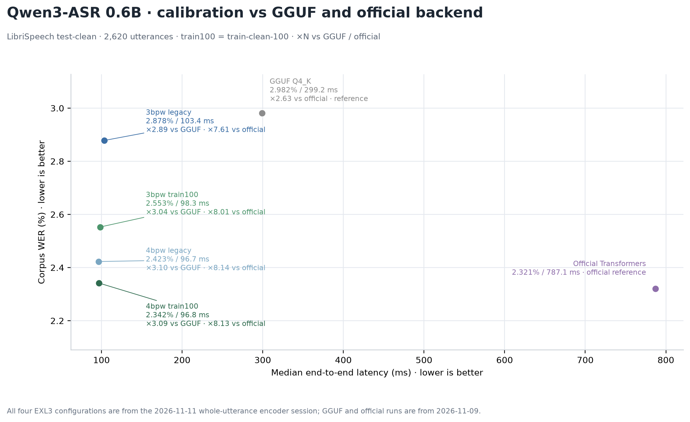
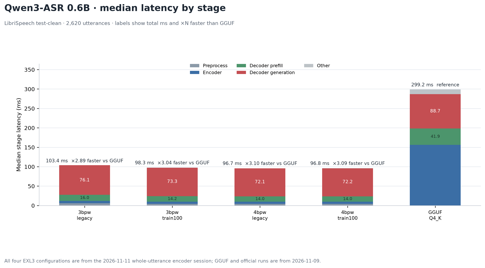
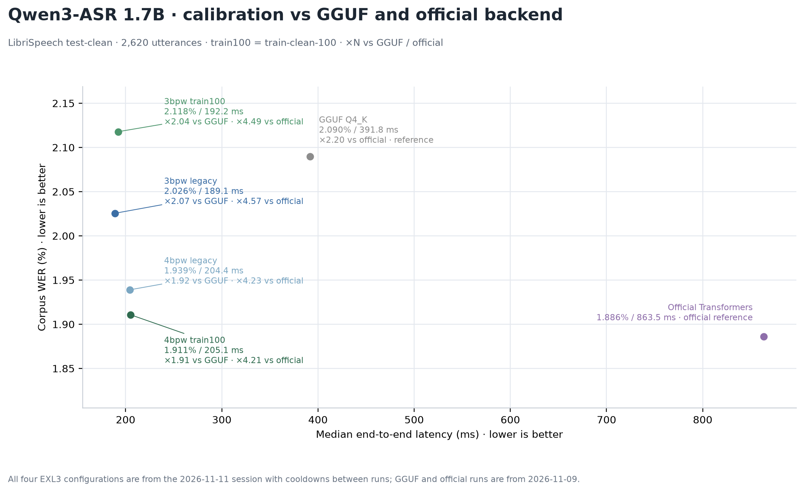
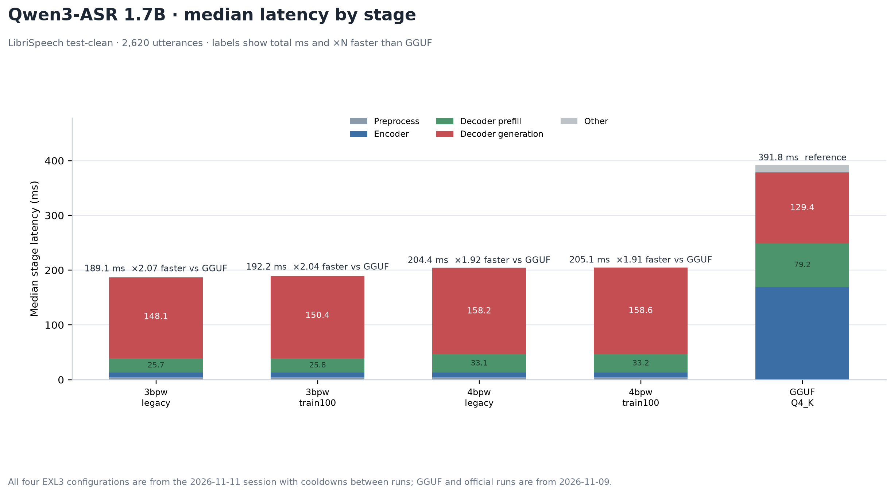
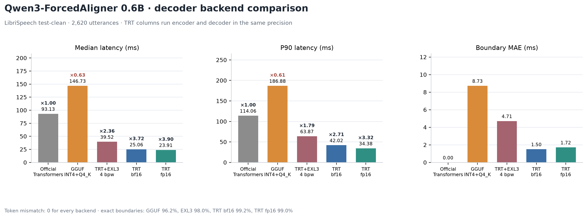
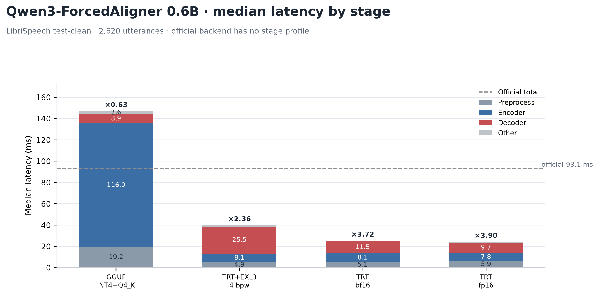

# Qwen3-ASR TensorRT

面向 Windows、基于 TensorRT 音频编码器和 ExLlamaV3 EXL3 文本解码器的 Qwen3-ASR 0.6B 与 1.7B 推理项目。本仓库集成 encoder 和 decoder，并提供 Python 命令行与 HTTP API。

[English](README.md) | [简体中文](README.zh-CN.md) | [模型文件说明](model-cards/)

## 运行环境

- Windows 10/11、NVIDIA GPU、CUDA 12.8
- Python 3.10–3.13 和 `uv`
- TensorRT 11.4.0.106
- 兼容的 PyTorch 和 ExLlamaV3 版本

Linux 环境在 CUDA、TensorRT、PyTorch 和 ExLlamaV3 软件包兼容时也可运行。

安装项目依赖：

```powershell
uv sync
```

## 模型

项目支持 [`Qwen/Qwen3-ASR-0.6B-hf`](https://huggingface.co/Qwen/Qwen3-ASR-0.6B-hf) 和 [`Qwen/Qwen3-ASR-1.7B-hf`](https://huggingface.co/Qwen/Qwen3-ASR-1.7B-hf)，提供 BF16、FP16 TensorRT encoder、本地可选的 INT8 Q/DQ encoder 校准，以及 EXL3 3/4 bpw decoder。

已发布的模型文件：

- [TensorRT encoder：BF16 和 FP16 ONNX](https://huggingface.co/Retrieve0/Qwen3-ASR-1.7B-TensorRT-Encoder)
- [EXL3 decoder：legacy 3 bpw 和 4 bpw](https://huggingface.co/Retrieve0/Qwen3-ASR-1.7B-EXL3-Decoder)
- [1.7B EXL3 3 bpw：使用 train-clean-100 重新校准](https://huggingface.co/Retrieve0/Qwen3-ASR-1.7B-EXL3-Decoder/tree/main/decoder-exl3-3bpw-train-clean-100)（同一 decoder 仓库中的独立目录）
- [1.7B EXL3 4 bpw：使用 train-clean-100 重新校准](https://huggingface.co/Retrieve0/Qwen3-ASR-1.7B-EXL3-Decoder/tree/main/decoder-exl3-4bpw-train-clean-100)（同一 decoder 仓库中的独立目录）
- [0.6B TensorRT encoder：BF16 和 FP16 ONNX](https://huggingface.co/Retrieve0/Qwen3-ASR-0.6B-TensorRT-Encoder)
- [0.6B EXL3 decoder：legacy 3 bpw 和 4 bpw](https://huggingface.co/Retrieve0/Qwen3-ASR-0.6B-EXL3-Decoder)
- [0.6B EXL3 3 bpw：使用 train-clean-100 重新校准](https://huggingface.co/Retrieve0/Qwen3-ASR-0.6B-EXL3-Decoder/tree/main/decoder-exl3-3bpw-train-clean-100)（同一 decoder 仓库中的独立目录）
- [0.6B EXL3 4 bpw：使用 train-clean-100 重新校准](https://huggingface.co/Retrieve0/Qwen3-ASR-0.6B-EXL3-Decoder/tree/main/decoder-exl3-4bpw-train-clean-100)（同一 decoder 仓库中的独立目录）
- [Qwen3-ForcedAligner 0.6B TensorRT encoder](https://huggingface.co/Retrieve0/Qwen3-ForcedAligner-0.6B-TensorRT-Encoder)
- [Qwen3-ForcedAligner 0.6B EXL3 4 bpw decoder](https://huggingface.co/Retrieve0/Qwen3-ForcedAligner-0.6B-EXL3-Decoder)

legacy 3 bpw 和 4 bpw 使用 ExLlamaV3 默认校准数据量化。`train-clean-100` 版本使用 LibriSpeech `train-clean-100` 校准，针对 LibriSpeech 风格的英语朗读调优；通用音频和中文 ASR 仍默认推荐 legacy 版本。

## 构建加速后端

构建 BF16 encoder engine 并提取文本 decoder：

```powershell
uv run qwen3-asr --model Qwen/Qwen3-ASR-1.7B-hf build
```

为不支持 BF16 的 GPU 构建 FP16 encoder：

```powershell
uv run qwen3-asr --model Qwen/Qwen3-ASR-1.7B-hf build --encoder-precision fp16
```

在本地构建实验性 INT8 encoder（不包含在已发布模型文件中）：

```powershell
uv sync --extra quantization
uv run qwen3-asr --model Qwen/Qwen3-ASR-1.7B-hf quantize-encoder .\calibration-audio --max-audio-files 32
uv run qwen3-asr --model Qwen/Qwen3-ASR-1.7B-hf build --encoder-precision int8
```

实验性的 TensorRT INT4 权重专用 encoder 导出会按 64 个值一组量化符合条件的 MatMul 权重；卷积和激活仍使用 FP16。先导出 ONNX，再构建 engine：

```powershell
uv run qwen3-asr --model Qwen/Qwen3-ASR-1.7B-hf quantize-encoder-int4
uv run qwen3-asr --model Qwen/Qwen3-ASR-1.7B-hf build --encoder-precision int4
```

准备本地 LibriSpeech `train-clean-100` 语料和 Qwen3-ASR 模型后，先生成 200 行校准数据，再显式使用训练数据进行量化。省略 `--cal-data` 时使用 ExLlamaV3 默认校准数据，legacy 版本就是这样生成的：

```powershell
uv run python tools\prepare_exl3_calibration.py .\LibriSpeech\train-clean-100 .\models\Qwen3-ASR-1.7B-hf .\artifacts\train-clean-100.safetensors --rows 200 --columns 2048
uv run qwen3-asr --model Qwen/Qwen3-ASR-1.7B-hf quantize --bits 3 --cal-data .\artifacts\train-clean-100.safetensors --cal-rows 200 --output-dir artifacts/qwen3-asr-1.7b/decoder-exl3-3bpw-train-clean-100
uv run qwen3-asr --model Qwen/Qwen3-ASR-1.7B-hf quantize --bits 4 --cal-data .\artifacts\train-clean-100.safetensors --cal-rows 200 --output-dir artifacts/qwen3-asr-1.7b/decoder-exl3-4bpw-train-clean-100
```

生成单独发布的 0.6B 版本时，使用 0.6B checkpoint 生成校准数据，并将权重输出到独立目录：

```powershell
uv run python tools\prepare_exl3_calibration.py .\LibriSpeech\train-clean-100 .\models\Qwen3-ASR-0.6B-hf .\artifacts\train-clean-100-0.6b.safetensors --rows 200 --columns 2048
uv run qwen3-asr --model Qwen/Qwen3-ASR-0.6B-hf quantize --bits 3 --cal-data .\artifacts\train-clean-100-0.6b.safetensors --cal-rows 200 --output-dir artifacts/qwen3-asr-0.6b/decoder-exl3-3bpw-train-clean-100
uv run qwen3-asr --model Qwen/Qwen3-ASR-0.6B-hf quantize --bits 4 --cal-data .\artifacts\train-clean-100-0.6b.safetensors --cal-rows 200 --output-dir artifacts/qwen3-asr-0.6b/decoder-exl3-4bpw-train-clean-100
```

TensorRT engine 会根据目标 GPU 和本机 TensorRT 环境在本地构建。

构建强制对齐器 encoder，并导出两种 decoder：

```powershell
# TensorRT encoder + TensorRT bf16/fp16 decoder
uv run qwen3-asr build-aligner

# 可选：EXL3 4 bpw decoder
uv run qwen3-asr --model Qwen/Qwen3-ForcedAligner-0.6B quantize --bits 4 --head-bits 16
```

## 转写音频

```powershell
uv run qwen3-asr --model Qwen/Qwen3-ASR-1.7B-hf transcribe .\audio.wav --backend tensorrt-exllama --language Chinese
```

## 对齐音频

```powershell
uv run qwen3-asr align .\audio.wav --text-file .\transcript.txt --language English --format srt --output .\audio.srt
```

`align` 默认使用 TensorRT encoder 和 TensorRT bf16 aligner decoder，支持 `--format json`、`--format srt`、`--format txt`；也可以用 `--text` 直接传入文本。`--decoder-precision fp16` 切换 fp16 engine（约快 8%，encoder 自动跟随），`--backend tensorrt-exllama` 切换到 EXL3 decoder，`--engine` / `--decoder-engine` 用于指定具体构建产物。


启动 HTTP API：

```powershell
uv run qwen3-asr --model Qwen/Qwen3-ASR-1.7B-hf serve --backend tensorrt-exllama
```

任何编程语言都可以通过 HTTP 提交音频数据：

```powershell
curl.exe -X POST "http://127.0.0.1:8000/v1/transcribe?language=Chinese" `
  -H "Content-Type: audio/wav" --data-binary "@audio.wav"
```

API 默认只监听本机地址，支持 WAV、MP3、FLAC、OGG、M4A 和 AAC 音频。

## 基准测试

LibriSpeech `test-clean` 全量 2,620 条音频、53,120 个参考词。

| 模型 | 后端 | Corpus WER | 中位延迟 ms |
| --- | --- | ---: | ---: |
| 0.6B | 官方 Transformers BF16 | 2.321% | 787.1 |
| 0.6B | GGUF INT4 + Q4_K | 2.982% | 299.2 |
| 0.6B | TensorRT BF16 + EXL3 4 bpw | 2.423% | 96.7 |
| 0.6B | TensorRT BF16 + EXL3 4 bpw，train-clean-100 | **2.342%** | 96.8 |
| 1.7B | 官方 Transformers BF16 | 1.886% | 863.5 |
| 1.7B | GGUF INT4 + Q4_K | 2.090% | 391.8 |
| 1.7B | TensorRT BF16 + EXL3 4 bpw | 1.939% | 204.4 |
| 1.7B | TensorRT BF16 + EXL3 4 bpw，train-clean-100 | **1.911%** | 205.1 |









强制对齐在同样语料上：TensorRT bf16 aligner decoder 25.06 ms 中位延迟，EXL3 4 bpw aligner decoder 39.52 ms；官方后端 93.13 ms，GGUF 146.73 ms。TensorRT 的边界有 99.2% 与官方完全相同。



